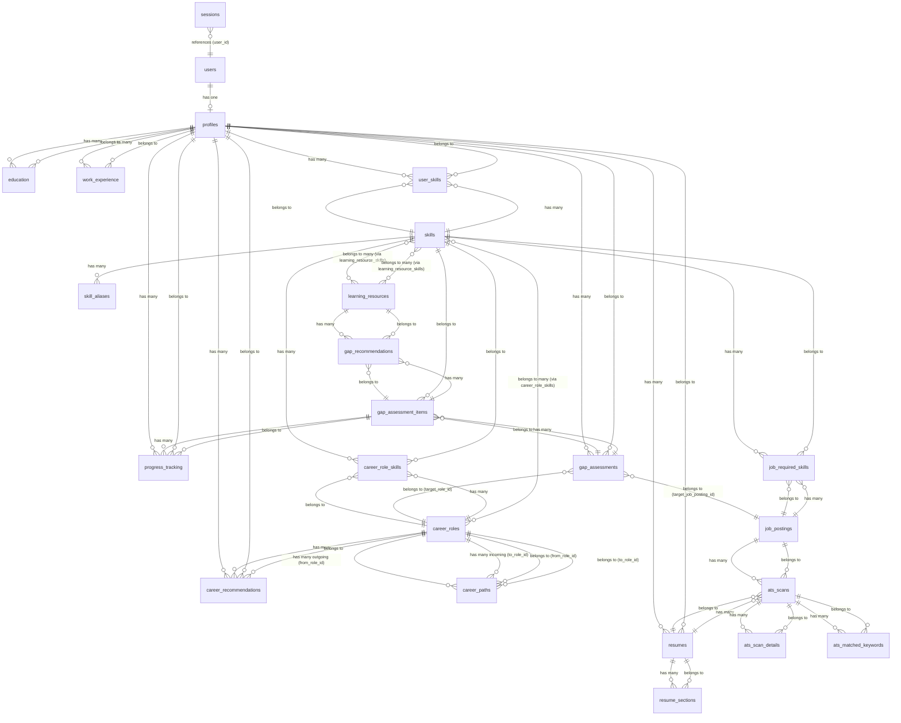

# Career Guidance System — Database Schema

> 32 tables across 8 domains. All user-facing tables use UUID primary keys.
> The `users` table is the exception — it uses auto-increment `bigint`.

---

## Table Index

### User & Auth (8 tables)
| # | Table | Purpose |
|---|-------|---------|
| 1 | `users` | Core user accounts |
| 2 | `profiles` | Extended career profile per user |
| 3 | `sessions` | PHP session storage |
| 4 | `password_reset_tokens` | Password reset flow |
| 5 | `failed_jobs` | Queue failed job tracking |
| 6 | `job_batches` | Queue batch tracking |
| 7 | `cache` | Application cache |
| 8 | `cache_locks` | Cache atomic locks |

### Profile Data (4 tables)
| # | Table | Purpose |
|---|-------|---------|
| 9 | `profiles` | Career profile (headline, bio, target roles) |
| 10 | `education` | Degree / institution history |
| 11 | `work_experience` | Work history with dates |
| 12 | `user_skills` | Skill assessments per user |

### Skills Taxonomy (2 tables)
| # | Table | Purpose |
|---|-------|---------|
| 13 | `skills` | Canonical skill definitions |
| 14 | `skill_aliases` | Alternate names for skills |

### Careers (4 tables)
| # | Table | Purpose |
|---|-------|---------|
| 15 | `career_roles` | Career titles with descriptions |
| 16 | `career_role_skills` | Required skills per career role |
| 17 | `career_paths` | Transitions between roles |
| 18 | `career_recommendations` | AI-generated role matches |

### Gap Analysis (3 tables)
| # | Table | Purpose |
|---|-------|---------|
| 19 | `gap_assessments` | Skill gap assessment sessions |
| 20 | `gap_assessment_items` | Per-skill gaps in an assessment |
| 21 | `gap_recommendations` | Learning resources matched to gaps |

### Learning (3 tables)
| # | Table | Purpose |
|---|-------|---------|
| 22 | `learning_resources` | Courses, articles, videos |
| 23 | `learning_resource_skills` | Skills taught by a resource |
| 24 | `progress_tracking` | User progress on gap items |

### Resumes & ATS (5 tables)
| # | Table | Purpose |
|---|-------|---------|
| 25 | `resumes` | Uploaded resume versions |
| 26 | `resume_sections` | Parsed sections of a resume |
| 27 | `ats_scans` | ATS compatibility scans |
| 28 | `ats_scan_details` | Per-category scan results |
| 29 | `ats_matched_keywords` | Keyword matches per scan |

### Job Postings (2 tables)
| # | Table | Purpose |
|---|-------|---------|
| 30 | `job_postings` | External job listings |
| 31 | `job_required_skills` | Skills required by a job |

### Laravel Internal (1 table)
| # | Table | Purpose |
|---|-------|---------|
| 32 | `migrations` | Migration version tracking |

---

## Table Structures

### 1. `users` (auto-increment PK)

| Column | Type | Nullable | Key | Notes |
|--------|------|----------|-----|-------|
| id | bigint unsigned | NO | PK | Auto-increment |
| name | varchar(255) | NO | | |
| email | varchar(255) | NO | UNI | |
| email_verified_at | timestamp | YES | | |
| password | varchar(255) | NO | | |
| role | varchar(255) | NO | | `user`, `admin`, etc. |
| remember_token | varchar(100) | YES | | |
| created_at | timestamp | YES | | |
| updated_at | timestamp | YES | | |

**Relationships:** hasOne(Profile)

---

### 2. `profiles` (UUID PK)

| Column | Type | Nullable | Key | Notes |
|--------|------|----------|-----|-------|
| id | char(36) | NO | PK | UUID |
| user_id | bigint unsigned | NO | FK → users.id | |
| headline | varchar(255) | YES | | |
| current_title | varchar(255) | YES | | |
| years_experience | int unsigned | YES | | |
| location | varchar(255) | YES | | |
| target_roles | json | YES | | |
| target_industries | json | YES | | |
| bio | text | YES | | |
| created_at | timestamp | YES | | |
| updated_at | timestamp | YES | | |

**Relationships:** belongsTo(User), hasMany(Education), hasMany(WorkExperience), hasMany(UserSkill), hasMany(Resume), hasMany(CareerRecommendation), hasMany(ProgressTracking)

---

### 3. `education` (UUID PK)

| Column | Type | Nullable | Key | Notes |
|--------|------|----------|-----|-------|
| id | char(36) | NO | PK | UUID |
| profile_id | char(36) | NO | FK → profiles.id | |
| institution | varchar(255) | NO | | |
| degree | varchar(255) | YES | | |
| field_of_study | varchar(255) | YES | | |
| start_date | date | YES | | |
| end_date | date | YES | | |
| created_at | timestamp | YES | | |
| updated_at | timestamp | YES | | |

**Relationships:** belongsTo(Profile)

---

### 4. `work_experience` (UUID PK)

| Column | Type | Nullable | Key | Notes |
|--------|------|----------|-----|-------|
| id | char(36) | NO | PK | UUID |
| profile_id | char(36) | NO | FK → profiles.id | |
| company | varchar(255) | NO | | |
| title | varchar(255) | NO | | |
| description | text | YES | | |
| start_date | date | YES | | |
| end_date | date | YES | | |
| is_current | tinyint(1) | NO | | Default 0 |
| created_at | timestamp | YES | | |
| updated_at | timestamp | YES | | |

**Relationships:** belongsTo(Profile)

---

### 5. `user_skills` (UUID PK)

| Column | Type | Nullable | Key | Notes |
|--------|------|----------|-----|-------|
| id | char(36) | NO | PK | UUID |
| profile_id | char(36) | NO | FK → profiles.id | |
| skill_id | char(36) | NO | FK → skills.id | |
| proficiency_level | smallint unsigned | NO | | 1–5 scale |
| source | varchar(255) | NO | | `self_reported`, `inferred`, `verified` |
| evidence_ref | char(36) | YES | | UUID linking to resume section, cert, etc. |
| confidence_score | decimal(5,2) | YES | | |
| last_used_date | date | YES | | |
| created_at | timestamp | YES | | |
| updated_at | timestamp | YES | | |

**Relationships:** belongsTo(Profile), belongsTo(Skill)

---

### 6. `skills` (UUID PK)

| Column | Type | Nullable | Key | Notes |
|--------|------|----------|-----|-------|
| id | char(36) | NO | PK | UUID |
| name | varchar(255) | NO | UNI | |
| category | varchar(255) | YES | | |
| taxonomy_source | varchar(255) | YES | | e.g. ESCO, O*NET |
| embedding | json | YES | | Vector embedding for semantic search |
| created_at | timestamp | YES | | |
| updated_at | timestamp | YES | | |

**Relationships:** hasMany(SkillAlias), hasMany(UserSkill), hasMany(CareerRoleSkill), hasMany(JobRequiredSkill), belongsToMany(LearningResource)

---

### 7. `skill_aliases` (UUID PK)

| Column | Type | Nullable | Key | Notes |
|--------|------|----------|-----|-------|
| id | char(36) | NO | PK | UUID |
| skill_id | char(36) | NO | FK → skills.id | |
| alias | varchar(255) | NO | | |
| created_at | timestamp | YES | | |
| updated_at | timestamp | YES | | |

**Relationships:** belongsTo(Skill)

---

### 8. `career_roles` (UUID PK)

| Column | Type | Nullable | Key | Notes |
|--------|------|----------|-----|-------|
| id | char(36) | NO | PK | UUID |
| title | varchar(255) | NO | UNI | |
| description | text | YES | | |
| typical_seniority | varchar(255) | YES | | |
| avg_salary_range | json | YES | | |
| growth_outlook | varchar(255) | YES | | |
| created_at | timestamp | YES | | |
| updated_at | timestamp | YES | | |

**Relationships:** hasMany(CareerRoleSkill), belongsToMany(Skill), hasMany(CareerPath [outgoing/incoming]), hasMany(CareerRecommendation)

---

### 9. `career_role_skills` (UUID PK)

| Column | Type | Nullable | Key | Notes |
|--------|------|----------|-----|-------|
| id | char(36) | NO | PK | UUID |
| career_role_id | char(36) | NO | FK → career_roles.id | |
| skill_id | char(36) | NO | FK → skills.id | |
| importance | varchar(255) | NO | | `essential`, `preferred`, `optional` |
| min_proficiency | smallint unsigned | NO | | 1–5 |
| created_at | timestamp | YES | | |
| updated_at | timestamp | YES | | |

**Relationships:** belongsTo(CareerRole), belongsTo(Skill)

---

### 10. `career_paths` (UUID PK)

| Column | Type | Nullable | Key | Notes |
|--------|------|----------|-----|-------|
| id | char(36) | NO | PK | UUID |
| from_role_id | char(36) | NO | FK → career_roles.id | |
| to_role_id | char(36) | NO | FK → career_roles.id | |
| typical_years | int unsigned | YES | | |
| notes | text | YES | | |
| created_at | timestamp | YES | | |
| updated_at | timestamp | YES | | |

**Relationships:** belongsTo(CareerRole [from_role_id]), belongsTo(CareerRole [to_role_id])

---

### 11. `career_recommendations` (UUID PK)

| Column | Type | Nullable | Key | Notes |
|--------|------|----------|-----|-------|
| id | char(36) | NO | PK | UUID |
| profile_id | char(36) | NO | FK → profiles.id | |
| career_role_id | char(36) | NO | FK → career_roles.id | |
| match_score | decimal(5,2) | NO | | 0.00–100.00 |
| rationale | text | YES | | |
| generated_at | timestamp | YES | | |
| created_at | timestamp | YES | | |
| updated_at | timestamp | YES | | |

**Relationships:** belongsTo(Profile), belongsTo(CareerRole)

---

### 12. `gap_assessments` (UUID PK)

| Column | Type | Nullable | Key | Notes |
|--------|------|----------|-----|-------|
| id | char(36) | NO | PK | UUID |
| profile_id | char(36) | NO | FK → profiles.id | |
| target_role_id | char(36) | YES | FK → career_roles.id | |
| target_job_posting_id | char(36) | YES | FK → job_postings.id | |
| overall_readiness_score | decimal(5,2) | NO | | |
| created_at | timestamp | YES | | |
| updated_at | timestamp | YES | | |

**Relationships:** belongsTo(Profile), belongsTo(CareerRole), belongsTo(JobPosting), hasMany(GapAssessmentItem)

---

### 13. `gap_assessment_items` (UUID PK)

| Column | Type | Nullable | Key | Notes |
|--------|------|----------|-----|-------|
| id | char(36) | NO | PK | UUID |
| gap_assessment_id | char(36) | NO | FK → gap_assessments.id | |
| skill_id | char(36) | NO | FK → skills.id | |
| required_level | smallint unsigned | NO | | |
| current_level | smallint unsigned | NO | | |
| gap_size | smallint | NO | | required − current |
| priority | varchar(255) | NO | | `High`, `Medium`, `Low` |
| created_at | timestamp | YES | | |
| updated_at | timestamp | YES | | |

**Relationships:** belongsTo(GapAssessment), belongsTo(Skill), hasMany(GapRecommendation), hasMany(ProgressTracking)

---

### 14. `gap_recommendations` (UUID PK)

| Column | Type | Nullable | Key | Notes |
|--------|------|----------|-----|-------|
| id | char(36) | NO | PK | UUID |
| gap_assessment_item_id | char(36) | NO | FK → gap_assessment_items.id | |
| learning_resource_id | char(36) | NO | FK → learning_resources.id | |
| rank | int unsigned | NO | | Recommendation order |
| created_at | timestamp | YES | | |
| updated_at | timestamp | YES | | |

**Relationships:** belongsTo(GapAssessmentItem), belongsTo(LearningResource)

---

### 15. `learning_resources` (UUID PK)

| Column | Type | Nullable | Key | Notes |
|--------|------|----------|-----|-------|
| id | char(36) | NO | PK | UUID |
| title | varchar(255) | NO | | |
| provider | varchar(255) | YES | | |
| url | varchar(255) | YES | | |
| resource_type | varchar(255) | NO | | `course`, `article`, `video`, `book`, `certification` |
| duration_hours | decimal(8,2) | YES | | |
| cost | decimal(10,2) | YES | | |
| created_at | timestamp | YES | | |
| updated_at | timestamp | YES | | |

**Relationships:** belongsToMany(Skill), hasMany(GapRecommendation)

---

### 16. `learning_resource_skills` (UUID PK, Pivot)

| Column | Type | Nullable | Key | Notes |
|--------|------|----------|-----|-------|
| id | char(36) | NO | PK | UUID |
| learning_resource_id | char(36) | NO | FK → learning_resources.id | |
| skill_id | char(36) | NO | FK → skills.id | |
| created_at | timestamp | YES | | |
| updated_at | timestamp | YES | | |

**Relationships:** belongsTo(LearningResource), belongsTo(Skill)

---

### 17. `progress_tracking` (UUID PK)

| Column | Type | Nullable | Key | Notes |
|--------|------|----------|-----|-------|
| id | char(36) | NO | PK | UUID |
| profile_id | char(36) | NO | FK → profiles.id | |
| gap_assessment_item_id | char(36) | NO | FK → gap_assessment_items.id | |
| status | varchar(255) | NO | | `not_started`, `in_progress`, `completed` |
| created_at | timestamp | YES | | |
| updated_at | timestamp | YES | | |

**Relationships:** belongsTo(Profile), belongsTo(GapAssessmentItem)

---

### 18. `resumes` (UUID PK)

| Column | Type | Nullable | Key | Notes |
|--------|------|----------|-----|-------|
| id | char(36) | NO | PK | UUID |
| profile_id | char(36) | NO | FK → profiles.id | |
| file_url | varchar(255) | NO | | |
| file_type | varchar(255) | YES | | |
| raw_text | text | YES | | Parsed text |
| parsed_json | json | YES | | Structured extraction |
| version | int unsigned | NO | | Incrementing version |
| is_primary | tinyint(1) | NO | | |
| uploaded_at | timestamp | YES | | |
| created_at | timestamp | YES | | |
| updated_at | timestamp | YES | | |

**Relationships:** belongsTo(Profile), hasMany(ResumeSection), hasMany(AtsScan)

---

### 19. `resume_sections` (UUID PK)

| Column | Type | Nullable | Key | Notes |
|--------|------|----------|-----|-------|
| id | char(36) | NO | PK | UUID |
| resume_id | char(36) | NO | FK → resumes.id | |
| section_type | varchar(255) | NO | | `summary`, `experience`, `education`, `skills` |
| content | text | YES | | |
| order_index | int unsigned | NO | | |
| created_at | timestamp | YES | | |
| updated_at | timestamp | YES | | |

**Relationships:** belongsTo(Resume)

---

### 20. `ats_scans` (UUID PK)

| Column | Type | Nullable | Key | Notes |
|--------|------|----------|-----|-------|
| id | char(36) | NO | PK | UUID |
| resume_id | char(36) | NO | FK → resumes.id | |
| job_posting_id | char(36) | YES | FK → job_postings.id | Null for generic scan |
| overall_score | decimal(5,2) | NO | | |
| keyword_match_score | decimal(5,2) | YES | | |
| formatting_score | decimal(5,2) | YES | | |
| structure_score | decimal(5,2) | YES | | |
| readability_score | decimal(5,2) | YES | | |
| created_at | timestamp | YES | | |
| updated_at | timestamp | YES | | |

**Relationships:** belongsTo(Resume), belongsTo(JobPosting), hasMany(AtsScanDetail), hasMany(AtsMatchedKeyword)

---

### 21. `ats_scan_details` (UUID PK)

| Column | Type | Nullable | Key | Notes |
|--------|------|----------|-----|-------|
| id | char(36) | NO | PK | UUID |
| ats_scan_id | char(36) | NO | FK → ats_scans.id | |
| category | varchar(255) | NO | | |
| detail | text | YES | | |
| severity | varchar(255) | NO | | `info`, `warning`, `error` |
| suggestion | text | YES | | |
| created_at | timestamp | YES | | |
| updated_at | timestamp | YES | | |

**Relationships:** belongsTo(AtsScan)

---

### 22. `ats_matched_keywords` (UUID PK)

| Column | Type | Nullable | Key | Notes |
|--------|------|----------|-----|-------|
| id | char(36) | NO | PK | UUID |
| ats_scan_id | char(36) | NO | FK → ats_scans.id | |
| keyword | varchar(255) | NO | | |
| matched | tinyint(1) | NO | | |
| frequency_in_resume | int unsigned | NO | | |
| frequency_in_jd | int unsigned | NO | | |
| created_at | timestamp | YES | | |
| updated_at | timestamp | YES | | |

**Relationships:** belongsTo(AtsScan)

---

### 23. `job_postings` (UUID PK)

| Column | Type | Nullable | Key | Notes |
|--------|------|----------|-----|-------|
| id | char(36) | NO | PK | UUID |
| source | varchar(255) | NO | | e.g. linkedin, indeed, manual |
| external_id | varchar(255) | YES | | |
| title | varchar(255) | NO | | |
| company | varchar(255) | YES | | |
| raw_description | text | YES | | |
| parsed_requirements | json | YES | | |
| seniority_level | varchar(255) | YES | | |
| location | varchar(255) | YES | | |
| embedding | json | YES | | Vector embedding |
| posted_at | timestamp | YES | | |
| created_at | timestamp | YES | | |
| updated_at | timestamp | YES | | |

**Relationships:** hasMany(JobRequiredSkill), hasMany(AtsScan)

---

### 24. `job_required_skills` (UUID PK)

| Column | Type | Nullable | Key | Notes |
|--------|------|----------|-----|-------|
| id | char(36) | NO | PK | UUID |
| job_posting_id | char(36) | NO | FK → job_postings.id | |
| skill_id | char(36) | NO | FK → skills.id | |
| importance | varchar(255) | NO | | `essential`, `preferred`, `optional` |
| min_proficiency | smallint unsigned | NO | | |
| created_at | timestamp | YES | | |
| updated_at | timestamp | YES | | |

**Relationships:** belongsTo(JobPosting), belongsTo(Skill)

---

### 25. `sessions` (string PK)

| Column | Type | Nullable | Key | Notes |
|--------|------|----------|-----|-------|
| id | varchar(255) | NO | PK | Session ID |
| user_id | bigint unsigned | YES | MUL | |
| ip_address | varchar(45) | YES | | |
| user_agent | text | YES | | |
| payload | longtext | NO | | |
| last_activity | int | NO | MUL | |

---

### 26. `password_reset_tokens` (string PK)

| Column | Type | Nullable | Key | Notes |
|--------|------|----------|-----|-------|
| email | varchar(255) | NO | PK | |
| token | varchar(255) | NO | | |
| created_at | timestamp | YES | | |

---

### 27. `failed_jobs` (auto-increment PK)

| Column | Type | Nullable | Key | Notes |
|--------|------|----------|-----|-------|
| id | bigint unsigned | NO | PK | Auto-increment |
| uuid | varchar(255) | NO | UNI | |
| connection | varchar(255) | NO | MUL | |
| queue | varchar(255) | NO | | |
| payload | longtext | NO | | |
| exception | longtext | NO | | |
| failed_at | timestamp | NO | | |

---

### 28. `job_batches` (string PK)

| Column | Type | Nullable | Key | Notes |
|--------|------|----------|-----|-------|
| id | varchar(255) | NO | PK | |
| name | varchar(255) | NO | | |
| total_jobs | int | NO | | |
| pending_jobs | int | NO | | |
| failed_jobs | int | NO | | |
| failed_job_ids | longtext | NO | | |
| options | mediumtext | YES | | |
| cancelled_at | int | YES | | |
| created_at | int | NO | | |
| finished_at | int | YES | | |

---

### 29. `cache` (string PK)

| Column | Type | Nullable | Key | Notes |
|--------|------|----------|-----|-------|
| key | varchar(255) | NO | PK | |
| value | mediumtext | NO | | |
| expiration | bigint | NO | MUL | |

---

### 30. `cache_locks` (string PK)

| Column | Type | Nullable | Key | Notes |
|--------|------|----------|-----|-------|
| key | varchar(255) | NO | PK | |
| owner | varchar(255) | NO | | |
| expiration | bigint | NO | MUL | |

---

### 31. `jobs` (auto-increment PK)

| Column | Type | Nullable | Key | Notes |
|--------|------|----------|-----|-------|
| id | bigint unsigned | NO | PK | Auto-increment |
| queue | varchar(255) | NO | MUL | |
| payload | longtext | NO | | |
| attempts | smallint unsigned | NO | | |
| reserved_at | int unsigned | YES | | |
| available_at | int unsigned | NO | | |
| created_at | int unsigned | NO | | |

---

### 32. `migrations` (auto-increment PK)

| Column | Type | Nullable | Key | Notes |
|--------|------|----------|-----|-------|
| id | int unsigned | NO | PK | Auto-increment |
| migration | varchar(255) | NO | | |
| batch | int | NO | | |

---

## Entity Relationship Diagram

---

## Relationship Summary

| Model | Relationships |
|-------|--------------|
| **User** | hasOne(Profile) |
| **Profile** | belongsTo(User), hasMany(Education), hasMany(WorkExperience), hasMany(UserSkill), hasMany(Resume), hasMany(CareerRecommendation), hasMany(ProgressTracking) |
| **Education** | belongsTo(Profile) |
| **WorkExperience** | belongsTo(Profile) |
| **UserSkill** | belongsTo(Profile), belongsTo(Skill) |
| **Skill** | hasMany(SkillAlias), hasMany(UserSkill), hasMany(CareerRoleSkill), hasMany(JobRequiredSkill), belongsToMany(LearningResource) |
| **SkillAlias** | belongsTo(Skill) |
| **CareerRole** | hasMany(CareerRoleSkill), belongsToMany(Skill), hasMany(CareerPath [outgoing]), hasMany(CareerPath [incoming]), hasMany(CareerRecommendation) |
| **CareerRoleSkill** | belongsTo(CareerRole), belongsTo(Skill) |
| **CareerPath** | belongsTo(CareerRole [from_role_id]), belongsTo(CareerRole [to_role_id]) |
| **CareerRecommendation** | belongsTo(Profile), belongsTo(CareerRole) |
| **GapAssessment** | belongsTo(Profile), belongsTo(CareerRole [target_role_id]), belongsTo(JobPosting [target_job_posting_id]), hasMany(GapAssessmentItem) |
| **GapAssessmentItem** | belongsTo(GapAssessment), belongsTo(Skill), hasMany(GapRecommendation), hasMany(ProgressTracking) |
| **GapRecommendation** | belongsTo(GapAssessmentItem), belongsTo(LearningResource) |
| **LearningResource** | belongsToMany(Skill), hasMany(GapRecommendation) |
| **LearningResourceSkill** | belongsTo(LearningResource), belongsTo(Skill) |
| **ProgressTracking** | belongsTo(Profile), belongsTo(GapAssessmentItem) |
| **Resume** | belongsTo(Profile), hasMany(ResumeSection), hasMany(AtsScan) |
| **ResumeSection** | belongsTo(Resume) |
| **AtsScan** | belongsTo(Resume), belongsTo(JobPosting), hasMany(AtsScanDetail), hasMany(AtsMatchedKeyword) |
| **AtsScanDetail** | belongsTo(AtsScan) |
| **AtsMatchedKeyword** | belongsTo(AtsScan) |
| **JobPosting** | hasMany(JobRequiredSkill), hasMany(AtsScan) |
| **JobRequiredSkill** | belongsTo(JobPosting), belongsTo(Skill) |
